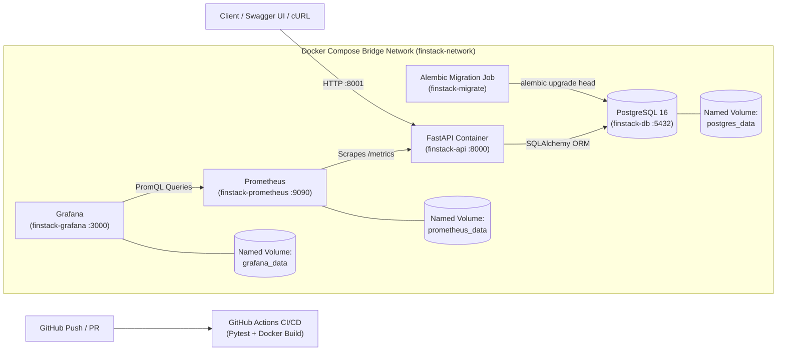

# FinStack API — Dockerized Fintech Wallet & Transaction Engine

A containerized fintech REST API built with **FastAPI**, **PostgreSQL**, **SQLAlchemy**, **Alembic**, **Docker Compose**, **GitHub Actions**, **Prometheus**, and **Grafana**.

> **Educational Simulation Notice:** FinStack API is an educational DevOps capstone project simulating double-entry style wallet operations, atomic transfers, and idempotency. It does not process real money or integrate live payment gateways.

---

## 1. Problem Statement & Objectives

Applications often behave differently across developer laptops, testing environments, and production servers due to dependency drift, OS differences, and manual database setups.

**FinStack API** solves environment drift by packaging the API, automated database migrations, PostgreSQL database, and observability stack into reproducible, isolated containers orchestrated via **Docker Compose**.

### Key Engineering Features
* **User Authentication:** JWT-based registration, login, and protected wallet ownership using Argon2 password hashing.
* **Wallet Management:** Create multi-currency wallets (`NGN`, `USD`, `GBP`, `EUR`), inspect details, and query real-time balances.
* **Financial Integrity:** Uses `Decimal` arithmetic (never floats), PostgreSQL ACID transactions, row-level locking to prevent race conditions, and `Idempotency-Key` headers to prevent duplicate charges.
* **Automated Migrations:** Dedicated `migrate` container executes `alembic upgrade head` before the API accepts traffic.
* **Observability:** Prometheus scrapes `/metrics` every 15s; Grafana renders pre-provisioned latency and request rate dashboards.
* **CI/CD Pipeline:** GitHub Actions runs automated `pytest` suites against a live PostgreSQL service container and validates Docker image builds on every push.

---

## 2. System Architecture



### Data Flow & Communication
1. **Startup Sequence:** `finstack-db` starts and passes its `pg_isready` health check. `finstack-migrate` runs Alembic migrations and exits `0`. `finstack-api` starts as a non-root user (`appuser`).
2. **Persistence:** All database records live in the named Docker volume `postgres_data`, surviving container restarts and recreations.
3. **Observability:** `finstack-prometheus` pulls anonymized HTTP metrics from `api:8000/metrics` over the internal bridge network without exposing sensitive user or financial PII.

---

## 3. Repository Structure

```text
finstack-api/
├── .github/workflows/       # GitHub Actions CI/CD pipeline
├── app/
│   ├── core/                # Password hashing & JWT security utilities
│   ├── models/              # SQLAlchemy ORM models (User, Wallet, Transaction)
│   ├── routes/              # FastAPI routers (auth, wallets, transactions)
│   ├── schemas/             # Pydantic request/response validation schemas
│   ├── services/            # Transactional business logic & idempotency
│   ├── database.py          # PostgreSQL engine & session configuration
│   └── main.py              # FastAPI entrypoint, health checks, & /metrics
├── migrations/              # Alembic database schema migration versions
├── monitoring/
│   ├── grafana/             # Auto-provisioned datasources & dashboards
│   └── prometheus/          # Prometheus scrape configuration
├── tests/                   # Pytest integration & financial integrity tests
├── .dockerignore            # Excludes secrets, venv, and cache from image
├── .env.example             # Safe environment variable template
├── docker-compose.yml       # Multi-container orchestration definition
├── Dockerfile               # Multi-stage, non-root production image build
└── requirements.txt         # Pinned Python dependencies
```

---

## 4. Quick Start & Installation

### Prerequisites
* **Docker Engine** 24+ and **Docker Compose** v2+
* **Git**

### Step 1: Clone & Configure Environment
```bash
git clone <your-github-repo-url>
cd finstack-api
cp .env.example .env
```
Edit `.env` and replace placeholder secrets (generate a 32-byte hex JWT secret with `openssl rand -hex 32`).

### Step 2: Build & Launch All Services
```bash
docker compose up -d --build
```

### Step 3: Verify Service Health
```bash
docker compose ps
curl http://localhost:8001/health
curl http://localhost:8001/ready
```

---

## 5. API Endpoints & Example Usage

Interactive Swagger UI is available at **http://localhost:8001/docs** and ReDoc at **http://localhost:8001/redoc**.

| Method | Endpoint | Auth | Description |
| :--- | :--- | :--- | :--- |
| `GET` | `/health` | No | Liveness probe for container health check |
| `GET` | `/ready` | No | Readiness probe verifying PostgreSQL connectivity |
| `POST` | `/auth/register` | No | Register a new user account |
| `POST` | `/auth/login` | No | Authenticate and receive a JWT access token |
| `POST` | `/wallets` | Bearer | Create a new wallet (`NGN`, `USD`, etc.) |
| `GET` | `/wallets/{id}/balance` | Bearer | Retrieve current wallet balance |
| `POST` | `/transactions/wallets/{id}/credit` | Bearer + Key | Credit funds (requires `Idempotency-Key`) |
| `POST` | `/transactions/wallets/{id}/debit` | Bearer + Key | Debit funds (prevents negative balances) |
| `POST` | `/transactions/transfer` | Bearer + Key | Atomic transfer between two wallets |
| `GET` | `/transactions/wallets/{id}` | Bearer | Paginated wallet transaction history |

---

## 6. Database Persistence Verification

To prove data persists across container restarts:
```bash
docker compose restart api db
```
All wallet balances and transaction history remain intact because PostgreSQL writes to the named Docker volume `postgres_data`.

---

## 7. Automated Testing & CI/CD

### Run Tests Locally
```bash
pytest -v
```
All **21 automated tests** validate authentication, wallet ownership, credit/debit rules, atomic transfers, insufficient balance rejection, and idempotency key enforcement.

### GitHub Actions Workflow
Located at `.github/workflows/ci.yml`, the pipeline triggers automatically on every push and pull request to `main`:
1. Spins up an ephemeral PostgreSQL 16 service container.
2. Installs pinned Python dependencies.
3. Executes `pytest -v`.
4. Builds the production multi-stage Docker image to verify container integrity.

---

## 8. Monitoring & Observability

* **Raw Metrics:** `http://localhost:8001/metrics`
* **Prometheus UI:** `http://localhost:9090` (Check **Status -> Targets** to verify `finstack-api` is `UP`)
* **Grafana UI:** `http://localhost:3000` (Default user: `admin`; password from `.env`)
  * Navigate to **Dashboards -> FinStack API Observability** to view target uptime, total request volume, request rate per endpoint, and p95 latency.

---

## 9. Security Considerations

* **Container Hardening:** Multi-stage `python:3.12-slim` build runs as non-root `appuser` with `.dockerignore` excluding `.env` and local caches.
* **Secrets Management:** Credentials are injected via environment variables and never hardcoded in images or version control.
* **SQL Injection Prevention:** All database queries use parameterized SQLAlchemy ORM statements.
* **Educational vs. Production Disclaimer:** A production banking deployment would additionally require TLS termination via a reverse proxy (Nginx/Traefik), managed secrets vaults (AWS Secrets Manager/Vault), API rate limiting, and automated off-site database backups.

---

## 10. Troubleshooting

* **Port Conflict on `8001`, `9090`, or `3000`:** Update the host port mapping in `docker-compose.yml` (e.g., `"8005:8000"`).
* **API Exits Immediately:** Verify `JWT_SECRET_KEY` in `.env` is at least 32 random bytes (`openssl rand -hex 32`).
* **Grafana Login Fails:** Confirm `GRAFANA_ADMIN_PASSWORD` is set in `.env` before the first container boot.

---

## 11. Demonstration Video & Screenshots

* **Demo Video:** `[Insert 2–3 Minute Demo Video Link Here]`
* **Screenshots:** Add screenshots of `docker compose ps`, Swagger UI (`/docs`), GitHub Actions green run, and Grafana dashboard inside a `docs/` folder.
