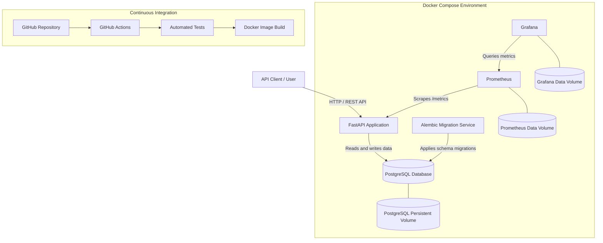

# FinStack API

A containerized fintech wallet and transaction REST API built with FastAPI, PostgreSQL, Docker, and modern DevOps practices.

[](https://github.com/Operahdam/finstack-api/actions/workflows/ci.yml)

## 1. Project Overview

FinStack API is a simulated financial wallet and transaction management platform developed as a DevOps capstone project for the 3MTT NextGen programme.

The application provides secure user authentication, wallet creation, balance management, and financial transaction processing through a RESTful API.

The project demonstrates how a backend application can be packaged, deployed, monitored, and tested using modern DevOps tools and workflows.

It focuses on application reliability, financial data integrity, containerization, automated testing, continuous integration, and observability.

**Note:** FinStack is an educational simulation. It is not connected to real banking infrastructure, payment gateways, or financial institutions and must not be used to process real funds.

## 2. Key Features

- **User Authentication:** Secure user registration and login using JWT-based authentication.
- **Wallet Management:** Create and retrieve individual user wallets.
- **Multi-currency Wallets:** Create wallets using three-letter uppercase currency codes, with NGN as the default.
- **Balance Management:** Retrieve wallet balances and currency information.
- **Financial Transactions:** Support wallet credits, debits, and transfers.
- **Transaction History:** Retrieve paginated transaction records.
- **Transaction Idempotency:** Use idempotency keys to prevent duplicate transaction processing.
- **Financial Integrity:** Apply database transactions, wallet row locking, and balance validation to protect financial operations.
- **Currency Validation:** Reject transfers between wallets with different currencies.
- **Database Migrations:** Manage database schema changes with Alembic.
- **Containerization:** Package and run the application using Docker.
- **Service Orchestration:** Manage the API, PostgreSQL, Prometheus, and Grafana through Docker Compose.
- **Automated Testing:** Validate application behaviour with Pytest.
- **Continuous Integration:** Automatically execute tests and build the Docker image through GitHub Actions.
- **Observability:** Monitor application metrics using Prometheus and Grafana.

## 3. Technology Stack

| Component | Technology |
|---|---|
| Programming Language | Python 3.12 |
| Backend Framework | FastAPI |
| Data Validation | Pydantic |
| ORM | SQLAlchemy |
| Database | PostgreSQL 16 |
| Database Migrations | Alembic |
| Authentication | JWT |
| Containerization | Docker |
| Orchestration | Docker Compose |
| Testing | Pytest |
| CI/CD | GitHub Actions |
| Metrics Collection | Prometheus |
| Monitoring Dashboard | Grafana |

## 4. System Architecture

FinStack API follows a containerized service architecture managed through Docker Compose.

### Application and Infrastructure Architecture



### Architecture Components

- **FastAPI:** Handles authentication, wallet management, transaction processing, and HTTP requests.
- **PostgreSQL:** Stores users, wallets, and financial transaction records.
- **Alembic:** Applies database schema migrations before the API starts.
- **Docker:** Packages the application and its runtime dependencies.
- **Docker Compose:** Coordinates the API, database, migration, and monitoring services.
- **Prometheus:** Scrapes application metrics from the API's `/metrics` endpoint.
- **Grafana:** Queries Prometheus and visualizes application performance and availability.
- **Persistent Volumes:** Preserve PostgreSQL, Prometheus, and Grafana data across container restarts.
- **GitHub Actions:** Automates testing and Docker image builds when changes are pushed or pull requests target the main branch.

## 5. Repository Structure

```text
finstack-api/
│
├── app/
│   ├── core/
│   │   └── security.py
│   ├── models/
│   │   ├── user.py
│   │   ├── wallet.py
│   │   └── transaction.py
│   ├── routes/
│   │   ├── auth.py
│   │   ├── wallets.py
│   │   └── transactions.py
│   ├── schemas/
│   │   ├── user.py
│   │   ├── wallet.py
│   │   └── transaction.py
│   ├── services/
│   │   ├── user_service.py
│   │   ├── wallet_service.py
│   │   └── transaction_service.py
│   ├── database.py
│   └── main.py
│
├── migrations/
│   ├── versions/
│   ├── env.py
│   ├── script.py.mako
│   └── README
│
├── monitoring/
│   ├── prometheus/
│   │   └── prometheus.yml
│   └── grafana/
│       ├── dashboards/
│       │   └── finstack-api.json
│       └── provisioning/
│           ├── dashboards/
│           │   └── dashboard.yml
│           └── datasources/
│               └── prometheus.yml
│
├── tests/
│   ├── conftest.py
│   ├── test_auth.py
│   ├── test_wallets.py
│   └── test_transactions.py
│
├── .github/
│   └── workflows/
│       └── ci.yml
│
├── .dockerignore
├── .env.example
├── .gitignore
├── alembic.ini
├── docker-compose.yml
├── Dockerfile
├── requirements.txt
└── README.md
```
## 6. Prerequisites

Before running FinStack API locally, ensure the following tools are installed:

- Python 3.12 or later
- Docker Engine
- Docker Compose
- Git

Verify your installations:

```bash
python --version
docker --version
docker compose version
git --version
```

## 7. Installation and Setup

### Step 1: Clone the repository

```bash
git clone https://github.com/Operahdam/finstack-api.git

cd finstack-api
```

### Step 2: Configure environment variables

Create your local environment file from the provided template:

```bash
cp .env.example .env
```

Open the `.env` file:

```bash
nano .env
```

Configure the database credentials and replace the placeholder JWT and Grafana passwords with strong, unique values.

Example configuration:

```env
# PostgreSQL
DB_HOST=db
DB_PORT=5432
DB_NAME=finstack_db
DB_USER=finstack_user
DB_PASSWORD=your-strong-database-password

# JWT Authentication
JWT_SECRET_KEY=your-secure-random-secret

# Grafana
GRAFANA_ADMIN_USER=admin
GRAFANA_ADMIN_PASSWORD=your-strong-grafana-password
```

**Important:** Never commit your actual `.env` file or expose your authentication secrets. The `.env.example` file is intended as a configuration template.

### Step 3: Build and start the services

Run:

```bash
docker compose up -d --build
```

Docker Compose builds the application image and starts the configured services.

Check the service status:

```bash
docker compose ps
```

The application stack consists of:

| Service | Purpose | Port |
|---|---|---|
| API | FastAPI application | 8001 |
| PostgreSQL | Database | 5432 |
| Prometheus | Metrics collection | 9090 |
| Grafana | Monitoring dashboard | 3000 |
| Migration | Database schema migration | Internal |

The migration service runs Alembic migrations before the API starts.

### Step 4: Verify the API

Open the interactive API documentation:

http://localhost:8001/docs

Check the API health endpoint:

```bash
curl http://localhost:8001/health
```

Expected response:

```json
{
  "status": "healthy",
  "application": "FinStack API"
}
```

Check the readiness endpoint:

```bash
curl http://localhost:8001/ready
```

### Step 5: Access monitoring tools

Prometheus:

http://localhost:9090

Grafana:

http://localhost:3000

Sign in to Grafana using the credentials configured in your `.env` file.

The provisioned FinStack dashboard provides visibility into API health, request volume, latency, and endpoint activity.

## 8. API Documentation

FinStack exposes RESTful endpoints for authentication, wallet management, and financial transactions.

All protected endpoints require a valid JWT bearer token.

### Authentication

| Method | Endpoint | Description |
|---|---|---|
| POST | `/auth/register` | Register a new user |
| POST | `/auth/login` | Authenticate and obtain an access token |
| GET | `/auth/me` | Retrieve the authenticated user's details |

#### Register a user

```bash
curl -X POST http://localhost:8001/auth/register \
-H "Content-Type: application/json" \
-d '{
  "email": "user@example.com",
  "password": "StrongPassword123!"
}'
```

Passwords must contain at least 12 characters.

#### Login

```bash
curl -X POST http://localhost:8001/auth/login \
-H "Content-Type: application/json" \
-d '{
  "email": "user@example.com",
  "password": "StrongPassword123!"
}'
```

The response contains an access token:

```json
{
  "access_token": "your-access-token",
  "token_type": "bearer"
}
```

Use the returned token in subsequent protected requests.

### Wallet Management

| Method | Endpoint | Description |
|---|---|---|
| POST | `/wallets` | Create a wallet |
| GET | `/wallets/{wallet_id}` | Retrieve a wallet |
| GET | `/wallets/{wallet_id}/balance` | Retrieve wallet balance |

#### Create a wallet

```bash
curl -X POST http://localhost:8001/wallets \
-H "Authorization: Bearer YOUR_ACCESS_TOKEN" \
-H "Content-Type: application/json" \
-d '{
  "currency": "NGN"
}'
```

The currency field is optional and defaults to NGN.

Wallet currencies must use a three-letter uppercase code, for example NGN, USD, GBP, or EUR.

The application validates the three-letter uppercase format rather than enforcing a fixed four-currency allowlist.

### Transaction Management

| Method | Endpoint | Description |
|---|---|---|
| POST | `/transactions/wallets/{wallet_id}/credit` | Credit a wallet |
| POST | `/transactions/wallets/{wallet_id}/debit` | Debit a wallet |
| POST | `/transactions/transfer?source_wallet_id={uuid}` | Transfer between wallets |
| GET | `/transactions/wallets/{wallet_id}` | Retrieve wallet transaction history |

All transaction requests require an `Idempotency-Key` header.

#### Credit a wallet

```bash
curl -X POST http://localhost:8001/transactions/wallets/YOUR_WALLET_ID/credit \
-H "Authorization: Bearer YOUR_ACCESS_TOKEN" \
-H "Content-Type: application/json" \
-H "Idempotency-Key: credit-001" \
-d '{
  "amount": "1000.00"
}'
```

#### Debit a wallet

```bash
curl -X POST http://localhost:8001/transactions/wallets/YOUR_WALLET_ID/debit \
-H "Authorization: Bearer YOUR_ACCESS_TOKEN" \
-H "Content-Type: application/json" \
-H "Idempotency-Key: debit-001" \
-d '{
  "amount": "250.00"
}'
```

#### Transfer between wallets

The source wallet ID is provided as a query parameter, while the destination wallet ID and amount are provided in the request body.

```bash
curl -X POST "http://localhost:8001/transactions/transfer?source_wallet_id=SOURCE_WALLET_ID" \
-H "Authorization: Bearer YOUR_ACCESS_TOKEN" \
-H "Content-Type: application/json" \
-H "Idempotency-Key: transfer-001" \
-d '{
  "destination_wallet_id": "DESTINATION_WALLET_ID",
  "amount": "100.00"
}'
```

Transfers between wallets with different currencies are rejected.

#### Retrieve transaction history

```bash
curl -X GET "http://localhost:8001/transactions/wallets/YOUR_WALLET_ID?skip=0&limit=20" \
-H "Authorization: Bearer YOUR_ACCESS_TOKEN"
```

The transaction history endpoint supports pagination through `skip` and `limit` query parameters.

## 9. Financial Integrity and Data Consistency

Financial operations require reliable transaction handling to prevent inconsistent wallet balances and incomplete transfers.

FinStack implements several safeguards:

- **Decimal Precision:** Monetary amounts use Python `Decimal` and PostgreSQL numeric columns rather than floating-point arithmetic.
- **Atomic Transactions:** Database transactions ensure financial updates are committed together or rolled back on failure.
- **Row-Level Locking:** Wallet records are locked during transaction processing to reduce race conditions.
- **Balance Validation:** Debit and transfer operations reject transactions that would result in a negative wallet balance.
- **Idempotency:** Unique idempotency keys help prevent duplicate transaction processing.
- **Currency Validation:** Transfers between wallets with different currencies are rejected.
- **Wallet Ownership:** Operations verify that wallets belong to the authenticated user.

These controls demonstrate core principles of financial data integrity within a simulated wallet system.

## 10. Database Migrations and Persistence

FinStack uses PostgreSQL as its primary database and Alembic for schema migrations.

Migrations are executed automatically by the Docker Compose migration service before the API starts.

To inspect migration history:

```bash
docker compose exec api alembic history
```

To check the current migration revision:

```bash
docker compose exec api alembic current
```

### Persistent Storage

Docker named volumes are configured to preserve service data across container restarts.

The configured volumes include:

- `postgres_data`
- `prometheus_data`
- `grafana_data`

Inspect the volumes:

```bash
docker volume ls
```

Restarting containers does not remove their named volumes.

**Warning:** Avoid using `docker compose down -v` unless you deliberately intend to delete the persistent volumes and their stored data.

## 11. Automated Testing

FinStack uses Pytest to validate application functionality and business logic.

The test suite covers:

- User registration and authentication.
- Wallet creation and retrieval.
- Wallet balance operations.
- Credit and debit transactions.
- Wallet transfers.
- Wallet ownership and access restrictions.
- Idempotency behaviour.
- Multi-currency transaction processing.
- Rejection of transfers between different currencies.

### Running the tests locally

Ensure the dedicated PostgreSQL test database is available and configured.

Run:

```bash
DB_NAME=finstack_test_db pytest -v
```

**Important:** The test configuration contains a database safety guard requiring the dedicated `finstack_test_db` database. Do not run the tests against the development database.

### Verified Test Results

The complete local test suite was executed successfully:

```text
23 passed, 1 warning
```

The warning relates to a Starlette/httpx test-client deprecation notice and did not prevent the tests from passing.

## 12. Continuous Integration with GitHub Actions

FinStack uses GitHub Actions to automate testing and Docker image builds.

The workflow is located at:

```text
.github/workflows/ci.yml
```

The pipeline is triggered by:

- Pushes to the `main` branch.
- Pull requests targeting the `main` branch.

### CI Pipeline Stages

1. Check out the repository.
2. Set up Python 3.12.
3. Install project dependencies.
4. Start a PostgreSQL 16 service for testing.
5. Generate a temporary JWT secret.
6. Execute the automated Pytest suite.
7. Build the Docker image.

The pipeline uses a dedicated PostgreSQL test database and does not publish the Docker image to a registry.

### Verified CI Execution

The following GitHub Actions execution was successfully verified:

| Item | Result |
|---|---|
| Workflow | FinStack CI |
| Run | #7 |
| Branch | main |
| Commit | `133fe2b` |
| Automated tests | Passed |
| Docker image build | Passed |
| Overall status | Successful |

View workflow executions:

https://github.com/Operahdam/finstack-api/actions

## 13. Monitoring and Observability

FinStack integrates Prometheus and Grafana to provide application observability.

### Prometheus

Prometheus collects application metrics from the API through the `/metrics` endpoint.

Access:

http://localhost:9090

The API is configured as a Prometheus scrape target.

### Grafana

Grafana provides a provisioned dashboard for monitoring application performance.

Access:

http://localhost:3000

The FinStack API Observability dashboard includes:

- API target health.
- Total HTTP requests.
- Request latency, including p95 latency.
- Request rate by endpoint.

### Verified Monitoring Components

The monitoring stack was tested locally:

- Prometheus health endpoint returned a healthy status.
- The API metrics endpoint returned Prometheus-formatted metrics.
- Prometheus successfully scraped the API target.
- Grafana health endpoint reported a healthy database connection.
- The FinStack observability dashboard loaded and displayed live metrics.

## 14. Security Considerations

The project incorporates several security-conscious implementation practices:

- JWT-based authentication for protected endpoints.
- Password length validation.
- Environment-based configuration for sensitive credentials.
- `.env` exclusion through `.gitignore` and `.dockerignore`.
- A non-root application user inside the Docker runtime image.
- Wallet ownership validation.
- Database constraints for financial data integrity.
- Restricted GitHub Actions workflow permissions.

### Production Considerations

FinStack is an educational capstone project and is not production-ready financial infrastructure.

A production deployment would require additional security and operational controls, including:

- Managed secrets storage and automated secret rotation.
- HTTPS and secure network configuration.
- Rate limiting and abuse protection.
- Centralized logging and alerting.
- Expanded concurrency and security testing.
- Database backup and disaster recovery procedures.
- Independent security review and penetration testing.
- Production deployment automation and image vulnerability scanning.

## 15. Troubleshooting

### API container is not starting

Inspect the logs:

```bash
docker compose logs api
```

Check all service statuses:

```bash
docker compose ps
```

### Database connection issues

Inspect PostgreSQL logs:

```bash
docker compose logs db
```

Check database health:

```bash
docker compose exec db pg_isready
```

### Migration failures

Inspect migration logs:

```bash
docker compose logs migrate
```

### Prometheus is not collecting metrics

Check the Prometheus configuration and target status:

http://localhost:9090/targets

Inspect Prometheus logs:

```bash
docker compose logs prometheus
```

### Grafana dashboard is unavailable

Inspect Grafana logs:

```bash
docker compose logs grafana
```

Verify the Grafana health endpoint:

```bash
curl http://localhost:3000/api/health
```

### Rebuild the application

```bash
docker compose up -d --build
```

## 16. Project Status

FinStack API has successfully completed its core implementation and local DevOps verification.

The following components have been implemented and tested:

| Component | Status |
|---|---|
| FastAPI application | Implemented |
| JWT authentication | Implemented |
| Wallet management | Implemented |
| Transaction processing | Implemented |
| Multi-currency handling | Implemented |
| Financial integrity safeguards | Implemented |
| PostgreSQL integration | Verified |
| Alembic migrations | Verified |
| Docker image build | Verified |
| Docker Compose services | Verified |
| Persistent database storage | Verified |
| Prometheus monitoring | Verified |
| Grafana dashboard | Verified |
| Automated test suite | 23 tests passed |
| GitHub Actions CI | Successful |

## 17. Author and Repository

**Project:** FinStack API
**Programme:** 3MTT NextGen DevOps Capstone Project

**GitHub Repository:**

https://github.com/Operahdam/finstack-api

**CI/CD Workflows:**

https://github.com/Operahdam/finstack-api/actions

---

*FinStack API demonstrates the practical application of backend development, containerization, automated testing, continuous integration, database management, and observability in a simulated fintech environment.*
